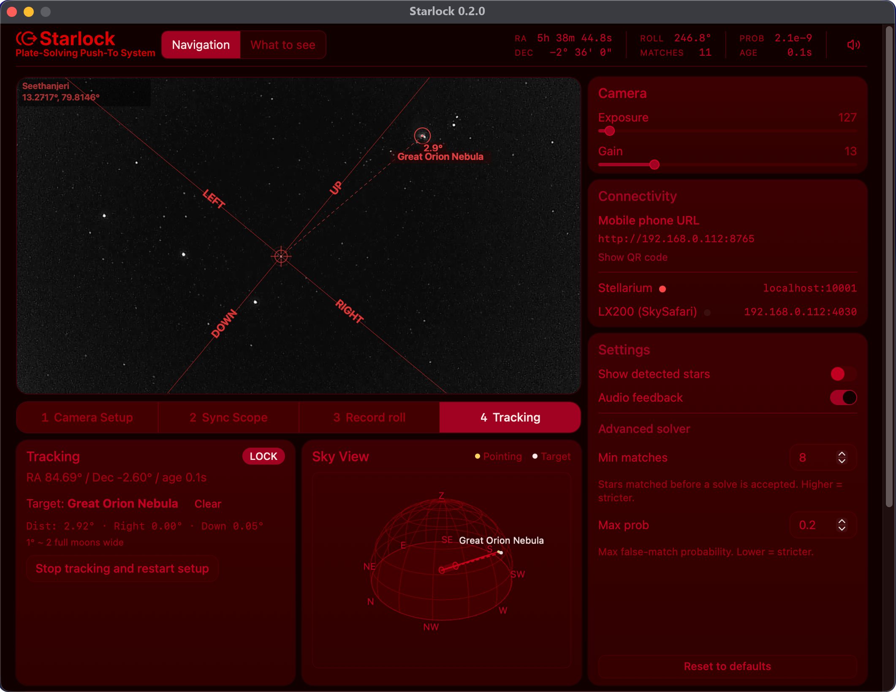
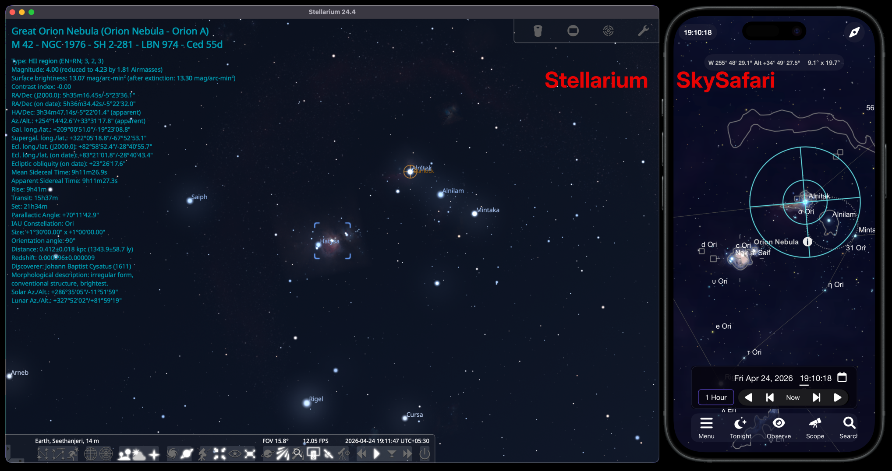
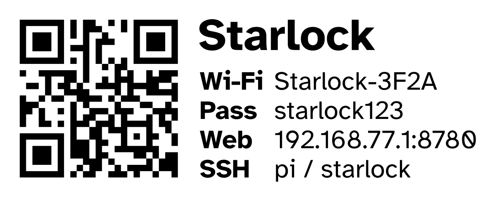

# Starlock

> **Starlock is a fork of PushNav**, created by Arun Venkataswamy at [meridianfield/pushnav](https://github.com/meridianfield/pushnav). It has been maintained and modified under this name by Kyle Downs since November 2026. Please report problems with it [here](https://github.com/kwdowns/starlock/issues), not upstream.

**A plate-solving push-to system for manual telescopes, running on a Raspberry Pi.** Add push-to navigation to a manual scope with a Pi and about **$50** of camera hardware you can order today.

**Three things, that's all:**

1. **A Raspberry Pi** — a Pi 3A+, 4 or 5 runs Starlock headless on the scope. You control it from your phone's browser or the Starlock phone apps.
2. **USB camera + lens** — about **$41 total**. A [Waveshare OV9281](https://www.waveshare.com/ov9281-1mp-usb-camera-a.htm) (~$26) plus a [25mm F2.4 M12 lens](https://www.seeedstudio.com/5MP-25mm-lens-p-5579.html) (~$15). See [Camera & Lens](docs/hardware.md) for details.
3. **Any manual telescope** — Dobsonian, manual EQ, or any push-around mount. No GOTO, no motors, no encoders.

Starlock uses a live camera feed to continuously plate-solve and determine where your telescope is pointing, reporting coordinates to **Stellarium** on the desktop and to **SkySafari**, **Stellarium Mobile**, **INDI**, or **ASCOM** clients over Wi-Fi in real time. Audio cues for lock, lost, and target alerts let you stay at the eyepiece without watching the screen.

Starlock runs [headless on a Raspberry Pi 3A+, 4 or 5](docs/rpi-headless.md) (beta) that rides on the scope with the camera. The Pi handles the plate-solving and serves the UI to any browser on the same Wi-Fi, so your phone or tablet becomes the screen. The live frame, Sky View dome, What to See catalog, and the planetarium-app servers are all on the same page. Install it with apt on a Pi you already use, or turn a fresh SD card into a dedicated Starlock box with its own Wi-Fi hotspot ([which way?](docs/rpi-headless.md#which-way-to-install)).

Starlock can also run completely standalone, without a separate planetarium app. Pick targets from its built-in What to See catalog. It offers a curated short-list of 161 hand-picked objects, a search across more than 20,000 stars and deep-sky objects, or a manual RA/Dec panel. Follow the push direction and watch your scope's pointing on the on-screen Sky View dome. The curated short-list is sourced from [Stargazing Buddy](https://stargazingbuddy.com/), an observing guide by Arun Venkataswamy, the author of the original PushNav.

> **What is plate-solving?**
>
> Any part of the night sky has a unique arrangement of stars. Plate-solving is a technique that takes a photo, matches that arrangement against a catalog, and reports exactly where the camera is pointing, down to a fraction of a degree. Starlock runs it continuously on the live camera feed, so the app always knows where your telescope is aimed.




Above: Starlock in tracking mode. The right-hand **Sky View** dome shows the current pointing (yellow) and the active GOTO target (cream) on a hemispheric grid above the local horizon.

It uses **tetra3rs**, a Rust port of the European Space Agency's (ESA) tetra3 fast lost-in-space plate solver. This efficient algorithm produces near real-time solutions on a live video feed.

Power your non-GOTO manual telescope with Starlock and enjoy seamless push-to navigation, even in light-polluted urban skies. All for under **$50** with an off-the-shelf USB UVC camera and lens. The same technology that powers spacecraft navigation and advanced astrophotography apps is now available for your backyard stargazing sessions.

📖 **Full documentation: [docs/](docs/index.md)**

## Push-to ops

Pick a target either inside Starlock or from any planetarium app you already use. Starlock's built-in **"What to See"** catalog covers a curated short-list, a fuzzy search across more than 20,000 stars and deep-sky objects, and a manual RA/Dec panel. Or stay in **Stellarium** on the desktop (or **SkySafari**, **Stellarium Mobile**, **INDI**, or **ASCOM** on a phone or tablet) and send the target from there. Either way, Starlock guides you to push the telescope to it, and your scope's live pointing moves on every connected app's sky chart in real time, staying in sync across all clients.



Above: **M42 (Orion Nebula)** is the active target on both **Stellarium** (desktop) and **SkySafari** (phone). As the scope is pushed, each plate-solve updates the telescope crosshair on every connected client simultaneously. No mount control, no GoTo motors. Just a camera and Wi-Fi.

## Who is Starlock for?

Starlock is probably a good fit if most of these describe you:

- You own a **manual telescope** — Dobsonian, manual EQ, or any push-around mount with no GOTO motors or encoders.
- You have (or don't mind getting) a **Raspberry Pi** 3A+, 4 or 5, and a phone or tablet to control it.
- You'd like to add push-to navigation to that scope for around **$50**, not the **$300+** that comparable products typically cost.
- You observe from **light-polluted skies** where star-hopping is hard, and want a faster way to land on faint targets.
- You're OK with a **brief one-time calibration** at the start of each session (it takes under a minute after the first run).

If you already have a GOTO mount, Starlock isn't the right tool — there are better-fitted products for that case.

## Platforms

Starlock ships as a headless package for the **Raspberry Pi**, the only supported host. The engine is written in Python and serves a React web UI over HTTP; it stays platform-agnostic and runs on **Windows**, **macOS**, and **Linux** PCs for development. The camera server is a native binary for each platform (Swift on macOS, C/V4L2 on Linux, C/DirectShow on Windows) to achieve maximum performance and compatibility with UVC cameras.

## How It Works

1. Observer picks a target from Starlock's built-in **What to See** catalog, or from a planetarium app (Stellarium on the desktop, or SkySafari / Stellarium Mobile PLUS / INDI / ASCOM on a phone or tablet), and sends it to Starlock.
2. Starlock shows how to push the telescope to reach the target in its UI.
3. Your telescope's pointing shows in real time on the on-screen **Sky View** dome. When a planetarium app is connected, it also appears as a live crosshair on the app's sky chart, staying in sync across all clients.

### Internal workflow

1. A USB camera in place of your telescope's finder captures the star field
2. Starlock plate-solves frames using **tetra3rs** (a Rust port of ESA's [tetra3](https://github.com/esa/tetra3)) star pattern recognition in near real-time
3. The difference in pointing is calculated and translated into directional guidance which is shown in the UI
4. Solved RA/Dec coordinates are exposed to connected planetarium apps over standard telescope-control protocols, so your telescope's pointing moves on the app's sky chart in real-time as you push.

## Features

- Near real-time plate solving (~20–140 ms per frame)
- One time, simple calibration. No named stars, just point at any bright star and sync
- GOTO navigation guidance for targets picked inside Starlock's **What to See** catalog or sent from your planetarium app (Stellarium, SkySafari, Stellarium Mobile, etc.)
- Built-in **"What to See"** target picker with three modes: **Buddy** (161 hand-picked deep-sky objects filterable by equipment, light-pollution tolerance and visual reward), **Advanced** (fuzzy search across 12,522 NGC objects from OpenNGC and 8,825 bright stars from HYG), and **Manual coordinates** (HMS/DMS RA/Dec entry for anything not in the catalogs). Visibility (alt/az, rise/transit/set) is recomputed live for your location and time; one click promotes the selected object to the GOTO target. Below-horizon objects can't be set as a target.
- Works with **SkySafari**, **Stellarium Mobile**, **INDI**, and **ASCOM** clients over Wi-Fi via the LX200 protocol, with `:D#` slew-status so SkySafari's "Stop / GoTo" button transitions correctly
- **Web interface**: open Starlock in any browser on the same Wi-Fi, or scan the QR code in the Settings panel with a phone; no app install required
- Live activity indicators in the app showing when Stellarium or LX200 clients are talking
- IAU 2006 J2000 ↔ JNow precession via `pyerfa` at the LX200 boundary (SkySafari expects JNow, Starlock stores J2000)
- Audio feedback for lock/lost/GOTO events
- **Raspberry Pi (headless):** the `starlock-headless` package runs Starlock as a background service on a Pi 3A+, 4 or 5, controlled from your phone. With no screen attached, the Pi's own LEDs show the status: red when it needs attention (no camera, error), green when it's working (needs sync, tracking, lost the stars). See the [Pi guide](docs/rpi-headless.md#status-light). Two ways to set it up:
  - **Install with apt** on a Pi you set up yourself, on your own Wi-Fi.
  - **Ready-made Starlock SD card:** flash Raspberry Pi OS Lite, copy the release's `.deb` and `user-data` onto the card, and boot. The Pi becomes a dedicated box with its own hotspot, `Starlock-XXXX`, at `http://192.168.77.1:8780`.
- Always-visible **Sky View** — an interactive 3D hemispheric dome rendered alongside the wizard, showing where the scope is pointing (yellow marker + semi-transparent red telescope cylinder) and where the target sits (cream marker with name label), with solid/dashed lines from the dome centre. Useful as a spatial check during sync, roll calibration, and tracking alike.
- Saves calibration for quick re-sync
- Works from urban light-polluted skies with the right camera/lens combo (see hardware guide)

## Prerequisites

- **Python 3.12+**
- **[uv](https://docs.astral.sh/uv/)**: Python package manager
- **Node.js 20+** with `npm` (for the React UI)
- A supported UVC camera

### macOS

- Xcode Command Line Tools (for Swift compiler)

### Linux

```bash
sudo apt install gcc libjpeg-dev gstreamer1.0-tools
```

| Package | Why |
|---|---|
| `gcc`, `libjpeg-dev` | Compile the V4L2 camera server (`make -C camera/linux`). MJPEG encoding uses libjpeg. |
| `gstreamer1.0-tools` | Provides `gst-play-1.0`, which `playsound3` shells out to for the lock / lost / GOTO audio alerts. `aplay` (`alsa-utils`) or `ffplay` (`ffmpeg`) also work as fallbacks. |

### Windows

- [Visual Studio Build Tools](https://visualstudio.microsoft.com/visual-cpp-build-tools/) (cl.exe)

## Setup

```bash
git clone https://github.com/kwdowns/starlock.git
cd starlock
uv sync
(cd web && npm install)
```

## Building the Camera Server

The camera server is a native binary that captures frames and streams them to Starlock over TCP. It must be built before running the app.

**macOS** (Swift / AVFoundation):
```bash
scripts/build_camera_mac.sh
```

**Linux** (C / V4L2):
```bash
make -C camera/linux
```

**Windows** (C / DirectShow): run from a VS Developer Command Prompt:
```cmd
camera\windows\build.bat
```

## Running

Running from the source tree is for development on a PC (Windows, macOS
or Linux). The engine opens no window: you use the UI in a browser.
There are two run modes:

### A. One-terminal run with the built React UI (recommended)

Build the React bundle once, then launch the Python engine — it serves
the built UI itself:

```bash
(cd web && npm run build)
uv run python -m evf.main
```

Then open `http://localhost:8780/` in your browser (or the port set by
`webserver.port` in the config). Re-run `npm run build` whenever you
change `web/src/**`.

### B. Two-terminal run with HMR (for active UI work)

Useful when you're iterating on React/Tailwind. The Python engine runs
as usual and Vite serves the UI on port `5173` with hot reload:

```bash
# terminal 1 — engine + camera
uv run python -m evf.main --dev

# terminal 2 — Vite dev server
(cd web && npm run dev)
```

Then open `http://localhost:5173/` in your browser. `--dev` also enables
the in-app DebugPanel and the `/api/dev/*` endpoints (sample injection,
frame capture). `--no-window` is still accepted for old scripts but
does nothing.

### Convenience scripts

The helper scripts prepare the tree and launch `evf.main`, which serves
the prebuilt bundle on `http://localhost:8780/`. So you can leave Vite
out and everything still works in one terminal:

```bash
scripts/run_dev.sh           # macOS — builds Swift camera, then evf.main
scripts/run_dev_linux.sh     # Linux — uv sync, installs npm deps and builds
                             #         React if missing, then evf.main
                             #         (assumes `make -C camera/linux` ran)
scripts\run_dev_windows.bat  # Windows — assumes camera\windows\build.bat ran first
```

If you want HMR, start `(cd web && npm run dev)` in another terminal
and open `http://localhost:5173/` instead (`run_dev.sh` then skips the
bundle rebuild).

### Dev mode

**`STARLOCK_DEBUG=1`** (equivalent to `--dev`) enables the engine's
in-app dev features: the React DebugPanel, the `/api/dev/*` endpoints,
sample-image injection, and frame capture. Works on macOS, Linux, and
Windows. On the headless Raspberry Pi package, a jumper from GPIO21
(pin 40) to GND (pin 39) does the same without environment variables;
see [Debug mode](docs/rpi-headless.md#debug-mode).

To debug the React UI, use your browser's own devtools.

## Building the Release

The only release build is the Raspberry Pi package,
`starlock-headless_<version>_arm64.deb`. It bundles a standalone Python
and is built in a Debian bookworm arm64 container; see
[docs/rpi-headless.md](docs/rpi-headless.md):
```bash
scripts/build_headless_deb.sh
scripts/smoke_test_headless_deb.sh   # install + run test on bookworm / trixie
```

Build output goes to `build/`.

**Label for a ready-made Pi**: a 50 × 20 mm label for the box, with a QR
code that opens Starlock and the hotspot name and password, web address
and SSH login. Give it the end of the Pi's hotspot name (`Starlock-3F2A`
here). It writes `starlock-label-3F2A.svg` and a 300 dpi
`starlock-label-3F2A.png` (`--dpi` for another resolution), taking the
passwords and address from `packaging/headless/user-data` (`--user-data`
for an edited copy). See
[Label for a ready-made Pi](docs/rpi-headless.md#label-for-a-ready-made-pi):
```bash
uv run python scripts/make_pi_label.py 3F2A
```



## Running Tests

```bash
uv run pytest tests/
```

Tests include offline plate-solving against sample images, camera protocol tests with a mock server, Stellarium and LX200 protocol tests, J2000↔JNow precession round-trips, sync/calibration math, and navigation computations. No camera hardware required.

## Stellarium Setup

1. Open Stellarium and enable the **Telescope Control** plugin (restart if needed)
2. Add a telescope: type **"External software or a remote computer"**
3. Host: `localhost`, Port: `10001`
4. Connect

For GOTO navigation guidance, also enable the **Remote Control** plugin (default port 8090).

To use **SkySafari**, **Stellarium Mobile**, **INDI**, or **ASCOM** instead, point your client at Starlock's LX200 server (shown in the app's Settings panel, port `4030`). Full walkthrough: [SkySafari & Other Apps](docs/skysafari-setup.md).

## Project Structure

```
python/evf/            Python application
  engine/              Core engine, state machine, plate-solve pointing, epoch helpers
  camera/              TCP client + subprocess lifecycle for the native camera server
  solver/              tetra3rs (Rust) plate-solve wrapper + body-frame sync
  stellarium/          Stellarium binary TCP server (port 10001)
  lx200/               LX200 Classic TCP server (port 4030, SkySafari / INDI / ASCOM)
  webserver/           aiohttp HTTP + WebSocket server (serves React, /ws, /frame.jpg, /frame.mjpg, /api/*)
  config/              JSON config + logging setup
  network.py           Shared LAN-IP probe used by webserver and engine
web/                   React + Vite + TypeScript + Tailwind + shadcn/ui front-end
camera/mac/            Swift camera server (macOS)
camera/linux/          C/V4L2 camera server (Linux)
camera/windows/        C/DirectShow camera server (Windows)
data/                  tetra3rs star catalog, sounds, version metadata (web_dist/ added on release builds)
hardware/3d_models/    3D-printable camera housing and accessories (OpenSCAD + STLs)
scripts/               Build and dev scripts
tests/                 Test suite
specs/start/           Design specifications
```

## 3D-Printable Hardware


The [`hardware/3d_models/`](hardware/3d_models/) directory contains OpenSCAD source and pre-built STLs. Everything prints without supports except the camera housing, which needs localised slicer supports at the USB cutout and the back chord-flat; any modern slicer places these automatically.

| Part | Description |
|------|-------------|
| **Camera Housing** (recommended) | The camera in a threaded housing on a rotation mount for the finder shoe: camera housing, hood and optional cap (`housing_v3_base.stl`, `housing_v3_hood.stl`, `housing_v3_cap.stl`) on the low mount (`housing_v3_mount.stl`), with the camera on a USB cable to the Pi. |
| **Pi 3A+ mount and box** (optional) | For running Starlock headless on a Raspberry Pi 3A+: a taller mount that carries the camera over a box for the Pi 3A+, in place of the low mount (`housing_v4_mount.stl`, `housing_v4_box_base.stl`, `housing_v4_box_lid.stl`). |
| **Laser Pointer Holder** | Cradle for a 23 mm laser pointer on a finder-shoe saddle, with heat-set inserts for the clamp screws and a tripod mount (`laser_pointer_holder.stl`). |
| **Spare Camera Base** | Replacement for the camera module's white base, fixed with hot glue (`camera_base.stl`). |
| **M12 Lock Ring** | Secures the lens at the correct focus position (`lock_ring.stl`). |
| **Camera Housings v2, v1** (deprecated) | Kept for existing builds: the v2 threaded housing (`housing_v2_*.stl`) and the v1 bolted housing (`housing_base_*.stl`, `housing_hood.stl`, `housing_cap.stl`). |

Pre-built STLs are in [`hardware/3d_models/stls/`](hardware/3d_models/stls/). See the [3D models README](hardware/3d_models/README.md) for hardware, print settings and build instructions, or the [3D Models](docs/3d-models.md) page in the docs.

## License

Copyright © 2026 Arun Venkataswamy  
Modifications in this fork copyright © 2026 Kyle Downs

This project is licensed under the [GNU General Public License v3.0](LICENSE) or later.

## Third-party data

The Advanced catalog search is backed by two vendored astronomical
databases. Each lives under `data/catalogs/<name>/` with its upstream
`LICENSE` and a `NOTICE` file recording the exact vendored version.

| Catalog | Upstream | License |
|---|---|---|
| OpenNGC | <https://github.com/mattiaverga/OpenNGC> | CC-BY-SA 4.0 |
| HYG v3  | <https://github.com/astronexus/HYG-Database> | CC-BY-SA (see `data/catalogs/hyg/LICENSE`) |

The build script `scripts/build_catalogs.py` trims these CSVs to the
JSON projections under `web/src/data/`; those derived files inherit
the CC-BY-SA licence.

The Pi label script `scripts/make_pi_label.py` uses the
[Atkinson Hyperlegible](https://github.com/googlefonts/atkinson-hyperlegible)
font, kept in `scripts/fonts/` with its SIL Open Font License
(`scripts/fonts/OFL.txt`).

