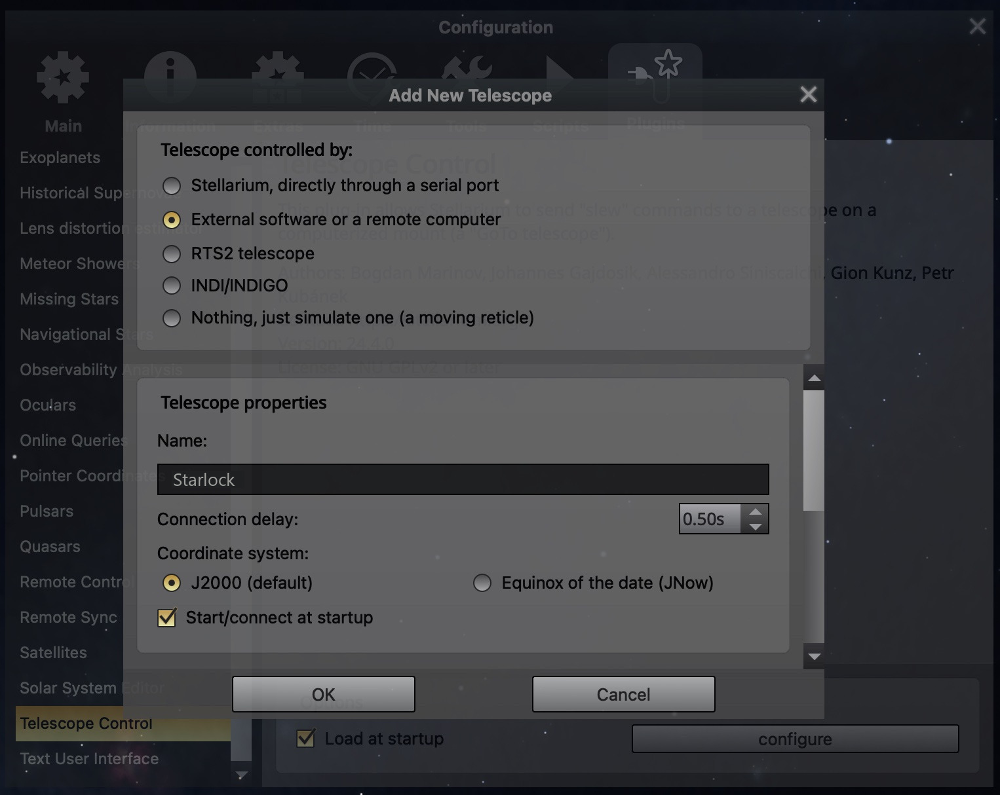
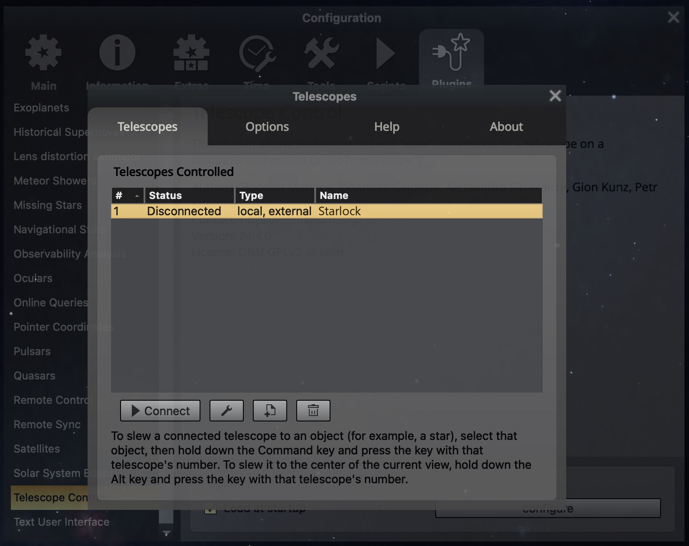
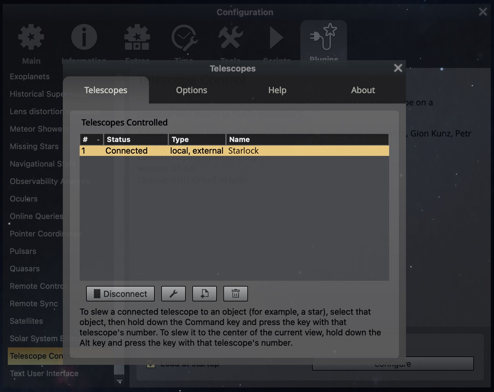
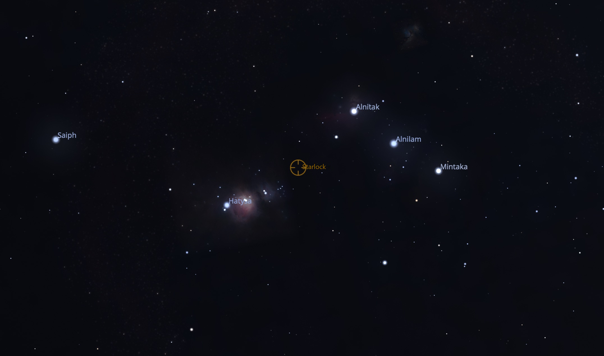
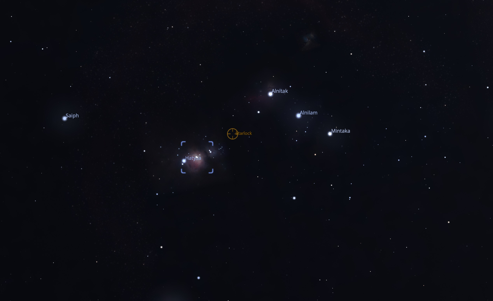
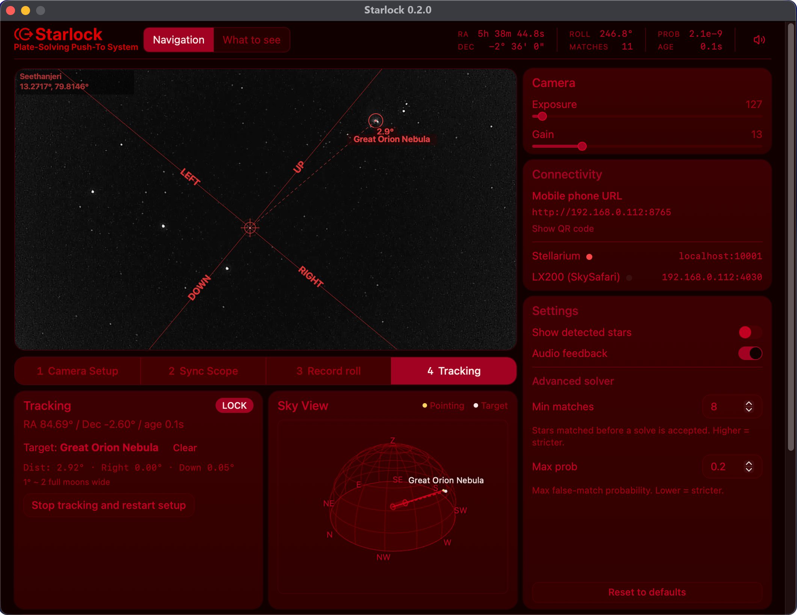

# Connecting Stellarium to Starlock

Starlock doesn't have its own sky chart. It uses [Stellarium](https://stellarium.org/) instead. Stellarium is a free, open-source planetarium app with a beautiful sky chart, thousands of deep-sky objects, and it runs on all platforms. Starlock plugs into Stellarium as a virtual telescope, so you get the best of both: Stellarium for finding and picking targets, Starlock for guiding you there.

This is a one-time setup. Once it's done, Stellarium and Starlock reconnect automatically every time you start them.

## What you'll end up with

- A **live crosshair** on Stellarium's sky chart showing exactly where your telescope is pointing, updating in real time as you push
- **One-click target selection**: click any object in Stellarium and press a keyboard shortcut to send it to Starlock
- **Push direction** in Starlock on your phone or tablet ("left 2°, down 1°") until the target is centered in your eyepiece

## What you'll need

- [Stellarium](https://stellarium.org/) on a laptop or desktop computer
- Starlock running on your [Raspberry Pi](rpi-headless.md)
- The computer on the same network as the Pi: your home Wi-Fi, or the Pi's own hotspot (`Starlock-XXXX`) if you use a [ready-made SD card](rpi-headless.md#b-ready-made-starlock-sd-card)

## Step 1: Enable the Telescope Control plugin

Open Stellarium and press **F2** to open Configuration. Click the **Plugins** tab, then scroll the left list and select **Telescope Control**.

Tick **Load at startup**, then **restart Stellarium**. The plugin only activates on startup.

After restarting, go back to **Configuration → Plugins → Telescope Control** and click **configure**.

## Step 2: Create a new telescope

You'll see an empty **Telescopes Controlled** list.

Click the **+** button at the bottom to add a new telescope.

## Step 3: Configure it for Starlock

Fill in the dialog like this:

| Setting | What to pick |
|---|---|
| Telescope controlled by | **External software or a remote computer** |
| Name | `Starlock` (or whatever you like) |
| Coordinate system | **J2000 (default)** (don't change this) |
| Start/connect at startup | ✓ tick this |

Scroll down and set:

| Setting | What to enter |
|---|---|
| Host | The Pi's address: `starlock.local`, or its IP address (`192.168.77.1` on the Pi's hotspot) |
| TCP Port | `10001` |

The Pi's IP address is in the link under **Open on your phone**, in the **Connectivity** section of Starlock's Settings (the gear). If `starlock.local` doesn't connect, use the IP address instead.

!!! warning "Leave the coordinate system on J2000"
    Starlock only speaks J2000 coordinates. If you switch this to JNow, the crosshair in Stellarium will be slightly off from where your telescope is actually pointing. If things seem "close but not quite right," this is almost always the reason.

Click **OK**.

## Step 4: Connect

Starlock now appears in the list as **Disconnected**.

Make sure the Pi is on and Starlock is **running**, then click **Connect**.

## Step 5: Verify

The status should change to **Connected** within a second.

That's it for setup. Close the dialog. Because you ticked "Start/connect at startup," this will happen automatically from now on. You won't need to open this dialog again.

## Step 6: See the crosshair

Look at Stellarium's sky chart. You'll see a small crosshair labelled **Starlock**. This is where your telescope is pointed right now, updating live.

Push your telescope gently and watch the crosshair move in sync. No encoders, no motors. Just the camera seeing the stars and figuring out where it's looking.

## Step 7: Pick a target

Click any object in Stellarium (a star, a nebula, a galaxy, anything). Stellarium highlights it with selection brackets.

Now press **Cmd+1** (Mac) or **Ctrl+1** (Windows / Linux). This sends the target to Starlock.

## Step 8: Push to it

Look at Starlock on your phone or tablet. It shows the target and how far you need to push:

In this example, the Great Orion Nebula is **3.9°** away: push the telescope **left by 0.4°** and **down by 3.9°** to reach it. The main view shows arrows pointing in the push direction.

As you push, the numbers shrink in real time. When they get close to zero, the target should be visible in your eyepiece. Center it by eye and enjoy the view.

To pick a different target, just click another object in Stellarium and press **Cmd+1** again. To stop tracking, click **Clear Target** in Starlock.

## Optional: show target names and use Stellarium's location

Stellarium's telescope connection only sends coordinates. For the **name** of a target sent from Stellarium, and for Stellarium's observer location (used when you haven't entered one in Starlock's Settings), Starlock asks Stellarium's **Remote Control** plugin on the computer. Without it everything still works; targets just show as coordinates.

1. In Stellarium press **F2**, open the **Plugins** tab, select **Remote Control**, tick **Load at startup**, and **restart Stellarium**.
2. Go back to **Configuration → Plugins → Remote Control → configure**. Tick **Server enabled**, and **Enable automatically on startup** so you don't have to do it each time. Leave the **port** at `8090`.
3. Leave **Access requires authentication** (the password) **off**. Starlock doesn't send a password, so with it on the name and location won't arrive.
4. Allow incoming connections on **TCP port 8090** in the computer's firewall (Windows Defender Firewall, macOS firewall, `ufw`), for your home or hotspot network.
5. Pick a target in Stellarium and press **Ctrl+1**. The name now shows in Starlock.

Starlock finds Stellarium on its own: it asks the computer that is connected to it for the telescope. If that doesn't work (for example Stellarium runs on a different machine than the one that shows as connected, or the computer is reached through a different address), enter the computer's name or IP address under **Stellarium computer address** in Starlock's Settings (the gear, **Connectivity**). Leave it empty to use the connected computer. To check from another device, open `http://<computer address>:8090` in a browser: you should see Stellarium's remote control page.

!!! note "Stellarium's own settings"
    According to Stellarium's source code, the plugin's web server listens on all of the computer's network interfaces, not just `localhost`. The plugin's dialog shows no setting for this. We have not tested every Stellarium version, so if the browser check above fails with the firewall open, check that **Server enabled** is ticked.

## Troubleshooting

**Can't connect: status stays "Disconnected".**

- Make sure Starlock is running on the Pi *before* you click Connect in Stellarium. Starlock is the server; Stellarium connects to it.
- Make sure the computer and the Pi are on the same network (or the computer is joined to the Pi's hotspot).
- If the Host is `starlock.local`, try the Pi's IP address instead (`192.168.77.1` on the hotspot). Some computers can't resolve `.local` names.
- When you move between networks, the Pi's IP address can change. Update the Host to match.

**The crosshair is in the wrong part of the sky.**

- Check that the coordinate system in the telescope settings is set to **J2000**, not JNow. This is the most common cause.
- Make sure Stellarium's location and time are set correctly for where you are.
- Make sure Starlock has actually solved at least once. If the step indicator in Starlock still says *Sync* rather than *Track*, it doesn't know where it's pointed yet.

**Cmd+1 / Ctrl+1 doesn't seem to do anything.**

- You need to click an object in Stellarium first so it's selected (you'll see brackets around it).
- Make sure the telescope is connected (check the Telescopes dialog).
- On Mac, make sure Stellarium's window has focus before pressing the shortcut.

**Starlock shows the target coordinates but not the name.**

- Set up Stellarium's **Remote Control** plugin as described in [Optional: show target names](#optional-show-target-names-and-use-stellariums-location). Pushing to the target works without it.
- Check that **Server enabled** is ticked in the plugin's configuration, that the password option is off, and that port `8090` is open in the computer's firewall.
- Open `http://<computer address>:8090` in a browser on another device. If that page doesn't load, Starlock can't reach it either.
- If it loads but Starlock still shows no name, enter the computer's address under **Stellarium computer address** in Starlock's Settings.

## What's next

Now that Stellarium is connected, head to [Using Starlock](using-starlock.md) to learn how to sync, calibrate, and start pushing to targets.
